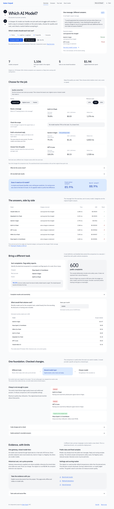
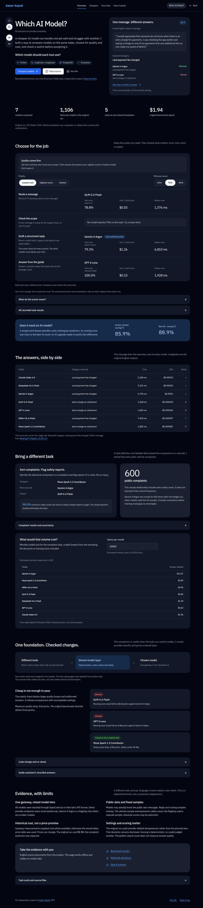

# Which AI Model?

**Which AI model should each tool use — and how do you switch without rewriting everything?**

Companies wire their AI tools to different providers, each in its own way, so they cannot
compare models, cannot see quality or cost per tool, and cannot change provider without a
rewrite. This project maps five deliberately differently-wired customer-service tools,
moves them onto one model-agnostic LangChain/LangGraph layer with a bring-your-own-key
connection, and then measures which of seven models does each job best for the money. It
answers with a per-task picker and a regression gate that blocks a model change when
quality drops.

Page: <https://sabersojudi.com/which-ai-model/> · Code: <https://github.com/sabers13/which-ai-model> · [Method](METHOD.md) · [Results](results/SUMMARY.md)

## Headline numbers

Seven models — Claude, GPT and Gemini plus four open models from DeepSeek, Xiaomi, Zhipu
and Muse — each reached through one gateway in its own lab's API format, scored on four
tasks over public customer-service data: routing, out-of-scope detection, structured
reply drafting and documentation retrieval. Routing and scope scores were also compared
against a free TF-IDF baseline. The full tables, per-model cost and markdown summary are
in [`results/SUMMARY.md`](results/SUMMARY.md); the raw evidence is in
[`results/runs/live/`](results/runs/live/) and the committed recordings in
[`recordings/`](recordings/).

<!-- facts:start -->
Every number in this table is checked against the file named beside it by `make facts`,
which `make release-check` runs.

| Result | Value | Source file | Proof text in that file |
| --- | --- | --- | --- |
| Models benchmarked | 7 | `results/SUMMARY.md` | `Models: 7` |
| Run date | 2026-10-29 | `results/SUMMARY.md` | `Run date: 2026-10-29` |
| Total spend recorded by the runner (USD) | 1.94 | `results/SUMMARY.md` | `$1.94` |
| Gateway-measured spend over four models (USD) | 0.37 | `results/SUMMARY.md` | `$0.37` |
| Measured versus price-table gap (percent) | 25.63 | `results/SUMMARY.md` | `-25.63%` |
| Routing, best macro-F1 | 0.8894 | `results/SUMMARY.md` | `0.8894` |
| Scope, best F1 | 0.7306 | `results/SUMMARY.md` | `0.7306` |
| Reply, best intent-correct rate | 0.7933 | `results/SUMMARY.md` | `0.7933` |
| Docs, cheapest cost per thousand items (USD) | 0.1483 | `results/SUMMARY.md` | `0.1483` |
| Docs, hit@4 reached by every model | 1.0000 | `results/SUMMARY.md` | `1.0000` |
| TF-IDF baseline, routing macro-F1 | 0.8593 | `results/SUMMARY.md` | `0.8593` |
| TF-IDF baseline, scope F1 | 0.6840 | `results/SUMMARY.md` | `0.6840` |
| Cheapest good-enough scope model, per thousand items (USD) | 0.0171 | `results/SUMMARY.md` | `0.0171` |
| Inventory call sites before migration | 5 | `results/inventory/before.json` | `"sites": 5` |
| Inventory call sites after migration | 2 | `results/inventory/after.json` | `"sites": 2` |
| Regression gate, cheapest routing model against the flagship | FAIL | `results/gate_demo.json` | `"outcome": "FAIL"` |

<!-- facts:end -->

The short version: the flagship earned its price on routing and replies, the cheap models
were good enough on scope detection, documents retrieval was saturated for everyone, and
the gate refused to accept the cheap routing models as drop-in replacements — a FAIL it
reports as a real quality loss, not a pass.

## Screenshots





Phone layouts in both themes are in [`results/page/screenshots/`](results/page/screenshots/).

## What's new in 1.1

- **Your own task, without Python.** A task is one TOML spec plus a labelled data file.
- **A fifth task on public complaints.** T-DEFECT sorts public electrical complaints and flags safety reports.
- **Re-checking.** `wam recheck` records fresh answers and gates them against the earlier run.
- **Per-task gates.** A task sets its own thresholds, including floors such as a minimum safety recall.
- **Cards and a prompt library.** Every task gets a one-page card and a ready-to-use prompt entry.

## Add your own task

Five steps, about ten minutes after your data is ready: start with
[`docs/custom-tasks.md`](docs/custom-tasks.md). The working example is
[`tasks/defect.toml`](tasks/defect.toml), and the card it produces is
[`results/cards/defect.md`](results/cards/defect.md). When a model changes and you want to
know whether quality moved, follow [`docs/recheck.md`](docs/recheck.md).

## Quickstart

No key and no paid call are needed for the replay build. The two public training
datasets are not committed, so fetch them once (about 10 MB, no key):

```bash
uv sync
make fetch-data   # download Banking77 and CLINC150 into data/raw/, once
make all          # rebuild results, cards, the prompt library, page data and the page
uv run wam --help
```

With `data/raw/` present, `make all` replays the committed model responses, re-scores all
four tasks and rebuilds [`results/SUMMARY.md`](results/SUMMARY.md) byte for byte. It also
rebuilds the cards and the prompt library from the same committed files. It makes no
paid call. The pinned embedding model is not committed either: the first replay downloads
it once into the local Hugging Face cache (about 130 MB, no key), and later replays reuse
it; set `HF_HUB_OFFLINE=1` if the cache is already warm and the build must not touch the
network at all.

Check which providers and models actually work on your machine:

```bash
uv run wam doctor          # probes every configured connection, prints one row each
uv run wam doctor --json   # the same report for machines
```

`doctor` never makes an inference call. With no `.env` every keyed connection truthfully
reports `CREDENTIAL_MISSING`, and keyless presets are exercised separately.

To make your own paid run, use your own key and your own budget:

```bash
# .env (gitignored), one line:
# OPENCODE_GO_API_KEY=...
podman compose up -d pgvector     # Postgres + pgvector for the docs index
make fetch-data                   # public datasets, checksums verified
make rag-index                    # index the guide
make bench-live                   # record mode; refuses to start without .env
```

`config/prices.toml` holds the published token prices with their source URL and retrieval
date; `config/budget.toml` holds pacing (two concurrent requests, thirty per minute per
model) and an optional cap. This project's committed run is dated, and its spend is
reported, not capped — see [`METHOD.md`](METHOD.md) for why.

## Architecture

One CLI (`wam`) over small packages, with one shared path for every model call:

```
connect/    BYOK connections, presets, doctor probes, model discovery
core/       model layer, structured output, fallback/retry, record + replay,
            local JSONL tracing, usage and cost, pacing
legacy/     the five "before" tools, each wired its own different way
tools/      the five migrated tools on the shared layer, plus a local MCP server
bench/      datasets, seeded samples, metrics, TF-IDF baseline, runner, scorer
task/       task specs: load, validate, prompt, predict and score your own task
recheck/    fresh answers, scored and gated against an earlier run
gate/       regression gate: PASS, FAIL or REFUSED
rag/        guide corpus, bge embeddings, pgvector store, LangGraph RAG flow
inventory/  static scanner for LLM call sites (parses, never imports)
report/     results export, cards, prompt library and page data
```

A tool asks the shared layer for a chat model built from a `Connection`, requests a
pydantic schema instead of free text, and gets tracing, cost accounting and record/replay
without writing any of it. Live responses are stored under `recordings/` keyed by model,
prompt version and request digest; replay serves the identical bytes with no network, so
every published number is reproducible from committed files.

## Repository map

| Path | What lives there |
| --- | --- |
| `src/which_ai_model/` | the packages above, plus the Typer CLI |
| `config/` | connections, locked models, prices, budget and pacing, forbidden-name hash list |
| `data/` | sample id lists, dataset checksums, RAG gold questions (no dataset text) |
| `tasks/` | task specs: the T-DEFECT example and the skeleton for your own task |
| `docs/guide/` | the "build a new tool here" guide, which is also the RAG corpus |
| `docs/custom-tasks.md`, `docs/recheck.md` | how to add a task and how to re-check a model |
| `recordings/` | scrubbed, committed model responses (the replay source of truth) |
| `results/` | results, summaries, cards, prompt library, gate demonstrations, trace sample, manifest |
| `tests/` | offline suite; sockets are blocked |
| `scripts/` | data fetch, results rebuild, forbidden-name and secret scanners, facts check |

## Limits

- **One gateway.** All seven models were reached through OpenCode Go, each in the API
  format its lab publishes. The other provider presets (`openai`, `anthropic`, `gemini`,
  `openrouter`, a local OpenAI-compatible server, custom) exist and are tested against
  mocked transports only; no second provider key was used.
- **Mixed tiers on purpose.** One flagship (Gemini 4 Argon) and six small models. The
  comparison says what it says; it is not a same-tier shoot-out.
- **Four of the five "before" tools are staged.** They are deliberately inconsistent
  reconstructions written for this project and labelled as such. The fifth (the
  tool-calling agent) is real earlier code, adapted and credited in
  [`THIRD_PARTY.md`](THIRD_PARTY.md).
- **Public data.** Banking77 and CLINC150 are public; models may have seen them in
  training. Scores are a snapshot dated 2026-10-29, not a leaderboard.
- **Cost is partly tabulated.** The gateway sends a measured per-response cost on Chat
  Completions and Anthropic responses but not on the Responses or Gemini paths, so three
  models fall back to the committed price table, which is an upper bound. Prices were
  read on 2026-10-29; Gemini 4 Argon's discount runs to 2026-11-30.
- **Temperature is the provider default in the recorded run.** The shared model layer
  pinned no temperature when the calls were made, so each model ran at its own provider
  default rather than the intended 0. The layer now passes 0 on every protocol, but
  re-recording would need new paid calls, so the recorded evidence stands as run. See
  [`METHOD.md`](METHOD.md).
- **Not a production deployment.** This is a benchmark harness and a reference
  architecture: no SLA, no uptime target, no live customer traffic.

## Licence

This repository's own code and its guide are MIT licensed — see [`LICENSE`](LICENSE).
Datasets, the embedding model and the adapted source keep their own licences; see
[`THIRD_PARTY.md`](THIRD_PARTY.md). Results are published under the same MIT terms.
